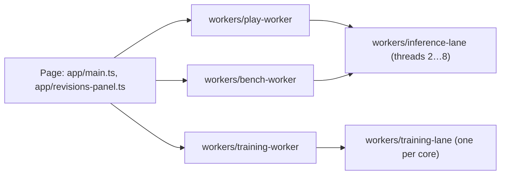

# Architecture

## Execution contexts

The page never runs inference or game steps on the main thread. Each long-running job owns a dedicated worker, and workers that need parallel CPU spawn nested workers:

- `play-worker` steps one arena and one inference runtime at the game's decision rate (two tics per decision at 35 tics per second) and posts frames with transferred pixel buffers.
- `training-worker` coordinates a run (EDNO generations, attribution or reference measurement) and plays its games on a pool of `training-lane` workers; each lane holds a private W4 model and arena. Results do not depend on which lane plays a game, which `tests/unit/training.test.ts` checks against in-process play.
- `inference-lane` workers share one `WebAssembly.Memory` with the threaded policy and wait on an `Atomics` ticket; this needs cross-origin isolation (see Deployment in `README.md`). The page hides its thread selector, so live play and the benchmark request one CPU thread; `tests/unit/model.test.ts` runs the threaded path.

## Why the build emits modules 1:1

`scripts/build.ts` compiles every `src/**/*.ts` to `docs/**/*.js` with `tsc` and copies `public/` beside it, instead of bundling. The page and five worker kinds load modules by URL, two of them from inside other workers. With a 1:1 emit every module keeps one predictable URL in development, in tests and in production, so `src/shared/site.ts` can resolve site files and worker scripts relative to its own location without bundler-specific worker syntax. The cost is one request per module.

`src/shared/site.ts` is the only place that knows the layout: compiled code resolves files against `docs/` and model packs against Hugging Face; code run by `bun test` resolves them against `public/` and `.cache/model/`. Tests therefore exercise the same loaders and WASM as the site, and packs with the same SHA-256 digests.

## Model and data integrity

- Model packs are verified by SHA-256 against the manifest before use (`src/model/kumo.ts`, and `chunkEncoding` in `src/revisions/store.ts`). The manifests come from the site origin and the packs from Hugging Face, so that host can make a download fail but cannot change the weights that run. The revision store and weight files additionally pin the manifests' own digests (`src/revisions/trust.ts`).
- A revision ID is the SHA-256 of its canonical, validated recipe (`src/revisions/store.ts`); shipped releases in `public/data/` load only when their computed ID equals the pinned one.
- Portable weight files (`.agmweights`) are verified chunk by chunk, including the ancestry chain and the materialized head, before anything is stored.

## Why the packs live on Hugging Face

The 18 packs total 99.4 MB. Committing them would put that much into every clone and, through `docs/`, into the deployed site. Loading them from Hugging Face keeps the repository to code and small data. VERIFIED: Hugging Face's resolve endpoint and its CDN redirect answer with `Access-Control-Allow-Origin`, so a CORS fetch works under the page's `Cross-Origin-Embedder-Policy: require-corp`, which `tests/e2e/site.spec.ts` exercises in Chromium. The URL pins a commit rather than `main`, so the packs cannot drift from the manifests in `public/model/`. Tests read a local copy in `.cache/model/` (`make models`), so they never call Hugging Face.

## Security and privacy

The site has no backend. Revisions, training receipts and run logs stay in the visitor's IndexedDB; recordings stay in memory until downloaded. Starting a model downloads its packs from `huggingface.co`, which redirects to its CDN (`us.aws.cdn.hf.co` when checked on 2026-11-05). Those hosts see the visitor's IP address, user agent and, under the default referrer policy, the site's origin. The requests carry no cookies, because `fetch` omits credentials on cross-origin requests by default. Imported weight files are parsed with strict field checks and size limits; display names reject control and bidirectional-override characters. Executable WASM always comes from the site origin; only verified data blobs may come from Hugging Face or an imported snapshot.

## Operations

`make start` serves `docs/` locally with the same isolation headers as `public/_headers`, logging one ISO-8601 line per request to `var/log/evoweights.stdout`. `make verify` runs lint, the unit and integration suites against the real WASM and packs, coverage and the Playwright run on the built site.
