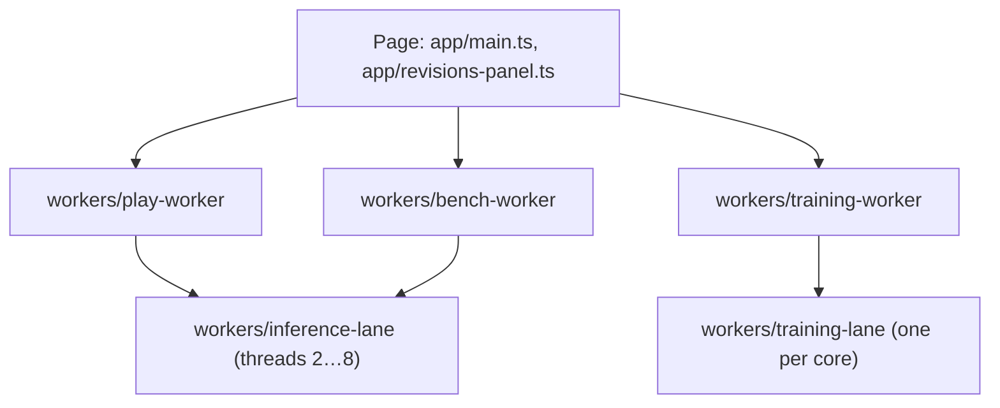

# Architecture

## Execution contexts

The page never runs inference or game steps on the main thread. Each long-running job owns a dedicated worker, and workers that need parallel CPU spawn nested workers:

- `play-worker` steps one arena at two tics per decision and 35 tics per second, posting transferred pixel buffers. Human play creates only the arena; AI play also opens an inference runtime. Switching from human to AI loads that runtime on demand.
- `training-worker` coordinates a run (EDNO generations, attribution or reference measurement) and plays its games on a pool of `training-lane` workers; each lane holds a private W4 model and arena. Results do not depend on which lane plays a game, which `tests/unit/training.test.ts` checks against in-process play.
- `inference-lane` workers share one `WebAssembly.Memory` with the threaded policy and wait on an `Atomics` ticket; this needs cross-origin isolation (see Deployment in `README.md`). The page hides its thread selector, so live play and the benchmark request one CPU thread; `tests/unit/model.test.ts` runs the threaded path.

## HuggingDOOM environment

VERIFIED: the rules live in `source/engine/source/arena.c`, with narrow hooks inserted into PureDOOM by `instrument.py`. Feeding and hugging disable a bear's attack and collision behavior while preserving it as a seated guest. New active bears reuse the five encounter slots after the existing respawn delay. A ring retains at most 256 peaceful guests; counters remain cumulative when the oldest visual guest is removed.

VERIFIED: player damage is intercepted before ordinary DOOM death and damage feedback. Each accepted bite removes one of five hearts, with 24 tics of bite immunity. Successful hugs hold the interaction for 24 tics, suppress bites and make nearby bears wait. The fifth bite starts a harmless 70-tic gathering. `picnic.activeTics` stops at that transition; `tic` continues for presentation. Training evaluation ends at the transition so the finale adds neither survival utility nor model experience.

VERIFIED: the 14-feature policy input, action numbers and internal `pistol`, `fist`, `shots`, `punches` and `kills` fields retain their ABI. In the new environment those represent honey, hugs and peaceful bears. Generated bear artwork changes visible occupancy; keeping the shape of an observation does not preserve its distribution or benchmark meaning.

VERIFIED: reference protocol `huggingdoom-v1.reference/1` and ruleset-scoped evaluation storage keys separate the new results from archived DOOM receipts and runs; `tests/unit/huggingdoom-revisions.test.ts` checks the key and predicate functions on constructed records, not on an IndexedDB that already holds pre-HuggingDOOM receipts and runs. Weight identities and imports stay compatible. A transferred model can be evaluated again without treating its old score as evidence for the new rules.

VERIFIED: `public/data/huggingdoom-reference-v1.json` supplies 48 fresh games for each built-in model, including FP32. Missing references are measured and cached: FP32 uses its unmodified decision policy before the W4 lane pool starts. Ranks use absolute survival totals, so missing FP32 evidence cannot produce rank zero. Completion comparisons wait for all required scores. Shared reference results drive the dialog, tree and model-card bars; cached built-in measurements avoid downloading every model just to display comparisons.

## Presentation and assets

VERIFIED: `scripts/build-huggingdoom-assets.py` converts retained generated PNG atlases into the existing WAD's patch, flat and palette formats. The existing engine, projection and occlusion sensors remain in use. The compiler replaces live bear, tool, meadow and impact imagery; supporting IWAD data retains its existing notices.

VERIFIED: `src/app/huggingdoom.ts` adds honey-flight, crumb, heart and finale effects to the displayed canvas. These overlays are included in recordings but are not policy input. The flight is visual: target resolution still uses the engine's instantaneous attack logic. Effects use game tics and honor reduced motion.

VERIFIED: hug poses use the engine's existing weapon animation sequence with four textured arm frames. This keeps the arms in the recorded framebuffer and damage palette without drawing a duplicate pair in the browser. A successful hug stops player momentum so the camera stays outside the bear. Walking bear patches are 48 by 48 pixels; fed, hugged and seated bear patches are 36 by 36 pixels. Both sizes keep their feet anchored to the ground.

VERIFIED: the site uses a fixed light appearance and shared honey-colour CSS tokens. Built-in model display names come from release metadata; renaming them keeps weight recipes, model identities and stored metric keys unchanged.

VERIFIED: `src/app/picnic-audio.ts` unlocks Web Audio after a user gesture. The supplied MP3 music loops during human and AI play, pauses with the game, and restarts from the beginning for a new game. A shared gain controls music and effects through the Sound toggle. Each bite selects one of five supplied ouch clips using randomness separate from the seeded simulation. Decoded audio stays in memory between games. `scripts/generate-picnic-sounds.py` reproduces the original nine WAV files; the chomp and dizzy files are retained but no longer loaded or played.

## Why the build emits modules 1:1

`scripts/build.ts` compiles every `src/**/*.ts` to `docs/**/*.js` with `tsc` and copies `public/` beside it, instead of bundling. The page and five worker kinds load modules by URL, two of them from inside other workers. With a 1:1 emit every module keeps one predictable URL in development, in tests and in production, so `src/shared/site.ts` can resolve site files and worker scripts relative to its own location without bundler-specific worker syntax. The cost is one request per module.

`src/shared/site.ts` is the only place that knows the layout: compiled code resolves files against `docs/` and model packs against Hugging Face; code run by `bun test` resolves them against `public/` and `.cache/model/`. Tests therefore exercise the same loaders and WASM as the site, and packs with the same SHA-256 digests.

## Model and data integrity

- Model packs are verified by SHA-256 against the manifest before use (`src/model/asset-cache.ts`, and `chunkEncoding` in `src/revisions/store.ts`). The manifests come from the site origin and the packs from Hugging Face, so that host can make a download fail but cannot change the weights that run. The revision store and weight files additionally pin the manifests' own digests (`src/revisions/trust.ts`).
- A revision ID is the SHA-256 of its canonical, validated recipe (`src/revisions/store.ts`); shipped releases in `public/data/` load only when their computed ID equals the pinned one.
- Portable weight files (`.agmweights`) are verified chunk by chunk, including the ancestry chain and the materialized head, before anything is stored.

VERIFIED: `src/model/asset-cache.ts` stores verified packs in Cache Storage for reuse across play, benchmarks, training, exports and page reloads. This avoids relying on HTTP cache headers or keeping a worker alive. Keys include the source URL, compressed and raw hashes, and byte lengths. Every cache read is verified; a damaged entry is deleted and fetched again. Web Locks coordinate concurrent downloads across workers and tabs where supported. Storage failures fall back to verified downloads. This cache contains weight data only; manifests and executable WASM retain their existing site-origin loaders. Browser tests cover reloads, concurrent workers, repaired entries and rejection of mismatched hashes.

## Why the packs live on Hugging Face

The 18 packs total 99.4 MB. Committing them would put that much into every clone and, through `docs/`, into the deployed site. Loading them from Hugging Face keeps the repository to code and small data. VERIFIED: Hugging Face's resolve endpoint and its CDN redirect answer with `Access-Control-Allow-Origin`, so a CORS fetch works under the page's `Cross-Origin-Embedder-Policy: require-corp`, which `tests/e2e/site.spec.ts` exercises in Chromium. The URL pins a commit rather than `main`, so the packs cannot drift from the manifests in `public/model/`. Unit tests read a local copy in `.cache/model/` (`make models`), so they never call Hugging Face. Browser tests exercise real downloads and subsequent cache reuse.

## Security and privacy

The site has no backend. Human play needs only site-origin game assets and does not download a model. Revisions, training receipts and run logs stay in the visitor's IndexedDB; recordings stay in memory until downloaded. Missing weight packs download from `huggingface.co`, which redirects to its CDN (`us.aws.cdn.hf.co` when checked on 2026-11-05). Those hosts see the visitor's IP address, user agent and, under the default referrer policy, the site's origin. The requests carry no cookies, because `fetch` omits credentials on cross-origin requests by default. Imported weight files are parsed with strict field checks and size limits; display names reject control and bidirectional-override characters. Executable WASM always comes from the site origin; only verified data blobs may come from Hugging Face or an imported snapshot.

## Operations

`python3 scripts/serve-preview.py` serves the included build without a toolchain install. `make start` rebuilds and serves `docs/` locally with the same isolation headers as `public/_headers`, logging one ISO-8601 line per request to `var/log/evoweights.stdout`. `make verify` runs lint, the unit and integration suites against the real WASM and packs, coverage and the Playwright run on the built site.
